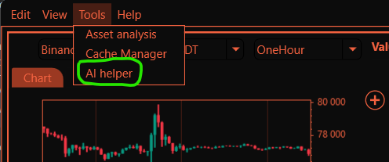
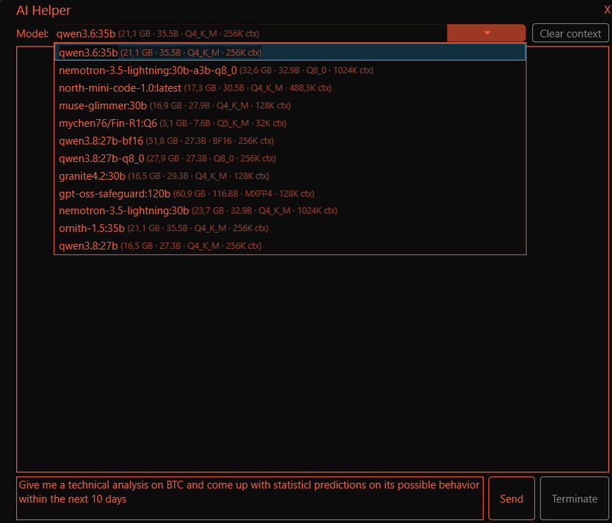
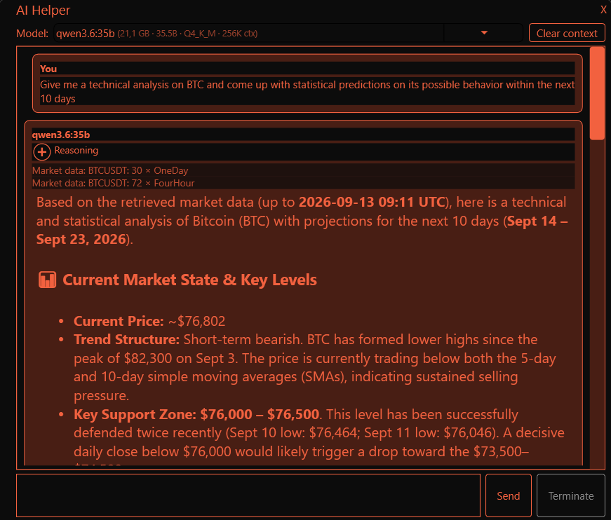

A tool for crypto-market analysis:

Main Menu => Tools => Asset analysis :

**Ollama-based AI Helper**
Install Ollama service (https://ollama.com/download/windows), pull some models with both "tools" and "thinking" capabilities (e.g., "qwen3", "nemotron",...) and enjoy a possibility to use an **AI Helper** feature to analyze the crypto-market and build statistically backed up predictions on the future behavior of crypto assets. **Main Menu** -> **Tools** -> **AI Helper**. Use shortcut names of the coins you want to analyze in your request and AI agent will automatically fetch the data necessary for the analysis from "Binance" service. 

The **Thinking** drop-down (low / medium / high) controls how much the model reasons before answering.

**Voice input**: if the Ollama server also has a model with "audio" capability (e.g., "lfm3-audio"), the first one is selected in the **Voice model** drop-down (choose "(none)" there to switch voice input off), and the **Microphone** drop-down lets you pick the recording device: the one you used last time, or the Windows default recording device at first. The drop-downs are hidden if there are no audio models or no microphones. A microphone button then appears next to **Send**: hold it (or hold the space bar while it is focused) and speak, then release it; a level indicator shows that the microphone picks up your voice. The recording is transcribed by the audio model and the text is placed into the input box for you to review before sending. Recordings are limited to 60 seconds. If recording fails, check that microphone access is allowed for desktop apps in Windows privacy settings.

**Disclaimer**: **AI Helper** is a statistics-based analysis tool, you are welcome to plan your investment activities based on its predictions but be aware of a risk that they may never come true.

